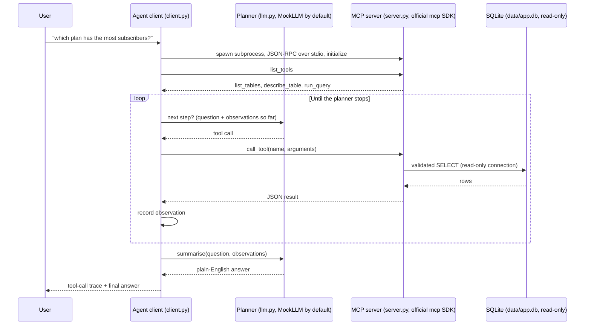

# mcp-data-agent

A real [Model Context Protocol](https://modelcontextprotocol.io) (MCP) server
that lets an agent explore a database **safely and read-only**, plus an agent
client that answers natural-language questions by discovering and calling the
server's tools over stdio.

## Problem statement

Giving a language-model agent direct database access is useful and risky in
equal measure: the same connection that answers "which plan has the most
subscribers?" can also run a `DELETE`. This project demonstrates the middle
path — an MCP server that exposes exactly three read-only tools over a real
database, enforces read-only access at several independent layers, and an
agent client that must explore the schema before it is allowed to query.
The whole loop runs offline with a deterministic planner, so anyone can
clone it, run one command, and watch every tool call happen.

## Architecture



Components:

| Path | Role |
|---|---|
| `src/mcp_data_agent/server.py` | MCP server on the official Python `mcp` SDK (v1), stdio transport |
| `src/mcp_data_agent/tools.py` | Transport-independent tool logic (unit-testable) |
| `src/mcp_data_agent/safety.py` | Read-only SQL validation and LIMIT capping |
| `src/mcp_data_agent/db.py` | Deterministic seed data (seed 42): telecom / e-commerce |
| `src/mcp_data_agent/client.py` | Agent client: session, tool discovery, call loop |
| `src/mcp_data_agent/llm.py` | Planner interface, deterministic `MockLLM`, optional env-configured provider |
| `src/mcp_data_agent/demo.py` | One-command offline demo |

## Quickstart

```bash
python3 -m venv .venv
.venv/bin/pip install -e '.[dev]'

# Run the demo (seeds the database on first run, spawns the server over stdio)
.venv/bin/python -m mcp_data_agent.demo "which plan has the most subscribers?"

# Other questions it answers
.venv/bin/python -m mcp_data_agent.demo "what is the total revenue?"
.venv/bin/python -m mcp_data_agent.demo "how many customers are there?"
.venv/bin/python -m mcp_data_agent.demo "which customers spend the most?"

# Run the server on its own (speaks MCP on stdin/stdout)
.venv/bin/python -m mcp_data_agent.server

# Tests (fully offline)
.venv/bin/python -m pytest
```

## Captured demo output

Real output, captured from an actual run of
`.venv/bin/python -m mcp_data_agent.demo "which plan has the most subscribers?"`
(long result lines are shortened by the demo printer itself, with `...`):

```text
Question: which plan has the most subscribers?
Tools discovered: list_tables, describe_table, run_query
Tool calls:
  1. list_tables()
     -> {"tables": [{"name": "customers", "row_count": 1200}, {"name": "invoices", "row_count": 4200}, {"name": "plans", "row_count": 6}, {"name": "subscriptions", "row_count": 1800}]}
  2. describe_table({"table": "plans"})
     -> {"table": "plans", "columns": [{"name": "id", "type": "INTEGER", "nullable": true, "primary_key": true}, {"name": "name", "type": "TEXT", "nullable": false, "primary_key": false}, {"name": "monthly_price_usd", "type": "REAL", "nullable": false, "primary_key": false}, {"name": "data_gb", "type": "INTEGER", "nullable": f...
  3. describe_table({"table": "subscriptions"})
     -> {"table": "subscriptions", "columns": [{"name": "id", "type": "INTEGER", "nullable": true, "primary_key": true}, {"name": "customer_id", "type": "INTEGER", "nullable": false, "primary_key": false}, {"name": "plan_id", "type": "INTEGER", "nullable": false, "primary_key": false}, {"name": "status", "type": "TEXT", "nulla...
  4. run_query({"sql": "SELECT p.name AS plan, COUNT(*) AS subscribers FROM subscriptions s JOIN plans p ON p.id = s.plan_id GROUP BY p.name ORDER BY subscribers DESC LIMIT 5"})
     -> {"columns": ["plan", "subscribers"], "rows": [{"plan": "Pro", "subscribers": 515}, {"plan": "Unlimited", "subscribers": 449}, {"plan": "Plus", "subscribers": 281}, {"plan": "Starter", "subscribers": 248}, {"plan": "Enterprise", "subscribers": 176}], "row_count": 5, "limit": 100, "truncated": true, "sql": "SELECT p.name...
Final answer: The plan with the most subscribers is Pro with 515 subscriptions.
```

A static version of this recorded run is also in
[`web/index.html`](web/index.html) — open it in any browser, no server needed.

## Dataset

Synthetic, neutral commercial data generated deterministically
(`random.Random(42)`, standard library only) on first use:

| Table | Rows | Contents |
|---|---:|---|
| `customers` | 1,200 | name, email, city, country, segment |
| `plans` | 6 | Basic, Starter, Plus, Pro, Unlimited, Enterprise |
| `subscriptions` | 1,800 | customer → plan, status, dates |
| `invoices` | 4,200 | subscription billing, amount, paid / pending / overdue |

Re-seed any time with `.venv/bin/python -m mcp_data_agent.db`
(the database file itself is git-ignored; the seed script is the source of
truth). Point the tools at a different database with `MCP_DATA_AGENT_DB`.

## Safety model

`run_query` is the only tool that touches user-shaped input, and it is
defended in depth — each layer would stop a write on its own:

1. **Lexical validation** (`safety.py`): the query must be a single
   statement starting with `SELECT` (or `WITH … SELECT`). Write / DDL /
   admin keywords (`INSERT`, `UPDATE`, `DELETE`, `DROP`, `ALTER`,
   `CREATE`, `PRAGMA`, `ATTACH`, …), SQL comments, and multiple
   statements are rejected before anything executes.
2. **Row limit**: a `LIMIT` is always applied and capped at 100 rows —
   a query asking for `LIMIT 1000` is silently capped, not trusted.
3. **Read-only connection**: SQLite is opened with a `mode=ro` URI, so
   the engine itself refuses writes.
4. **Engine authorizer + timeout**: user SQL runs under a SQLite
   authorizer that allows only `SELECT` / read / function actions, and a
   progress-handler deadline aborts queries after 5 seconds.

`list_tables` and `describe_table` run only hardcoded internal queries;
`describe_table` validates the requested name against the real table list
instead of interpolating untrusted input.

## Design decisions

- **Real SDK, thin server.** The server uses the official Python `mcp`
  SDK (pinned to the v1 line in `pyproject.toml`, where the server class
  used here is stable). It is a thin wrapper: all logic lives in
  `tools.py`, so it is testable without a subprocess.
- **Planner interface, not a model dependency.** The client depends on a
  two-method planner protocol (`next_step` / `summarise`). The default
  `MockLLM` is a deterministic, heuristic planner: schema first
  (`list_tables`, then `describe_table` for the tables the question
  touches), then one aggregate query built from the question pattern,
  then a templated answer. No keys, no network, reproducible runs.
- **Optional real provider via environment only.** If
  `MCP_DATA_AGENT_LLM_ENDPOINT`, `MCP_DATA_AGENT_LLM_MODEL` and
  `MCP_DATA_AGENT_LLM_API_KEY` are all set, `planner_from_env()` swaps in
  an `EnvLLM` that talks to that generic chat-completions style endpoint
  with the standard library. No provider is hardcoded or required.
- **Deterministic data.** Fixed-seed generation means tests can assert
  exact counts and the demo answer never drifts between machines.
- **stdio transport.** The simplest real MCP transport: no ports, no
  network surface, and the server lifecycle is owned by the client.

## Limitations

- The heuristic planner covers a bounded set of question patterns
  (subscribers, revenue, averages, top customers, counts, per-city,
  plan prices) and falls back to a customer count. It is a stand-in for a
  model, not a replacement for one.
- SQLite only, and a single bundled dataset. Other databases would need
  a different connection / authorizer layer behind the same tools.
- Lexical SQL validation is conservative by design: some legitimate
  read queries (for example, ones containing SQL comments, or the word
  `into` in a string literal) are rejected.
- One query per question in the default planner; multi-step analysis
  (query, inspect, query again) is a property of the interface, not of
  the mock.
- stdio transport only — no HTTP / remote hosting in this version.

## Tests

```text
10 passed
```

Covering: table listing and exact seeded counts, schema description,
SELECT execution, rejection of `DELETE` / `UPDATE` / `INSERT` / `DROP` /
multi-statement payloads (with data verified untouched), row-limit
enforcement (explicit limit and hard cap), and an integration test that
launches the real server over stdio, discovers its tools, and completes
one question end to end, cross-checked against a direct query.

## License

MIT — see [LICENSE](LICENSE).
